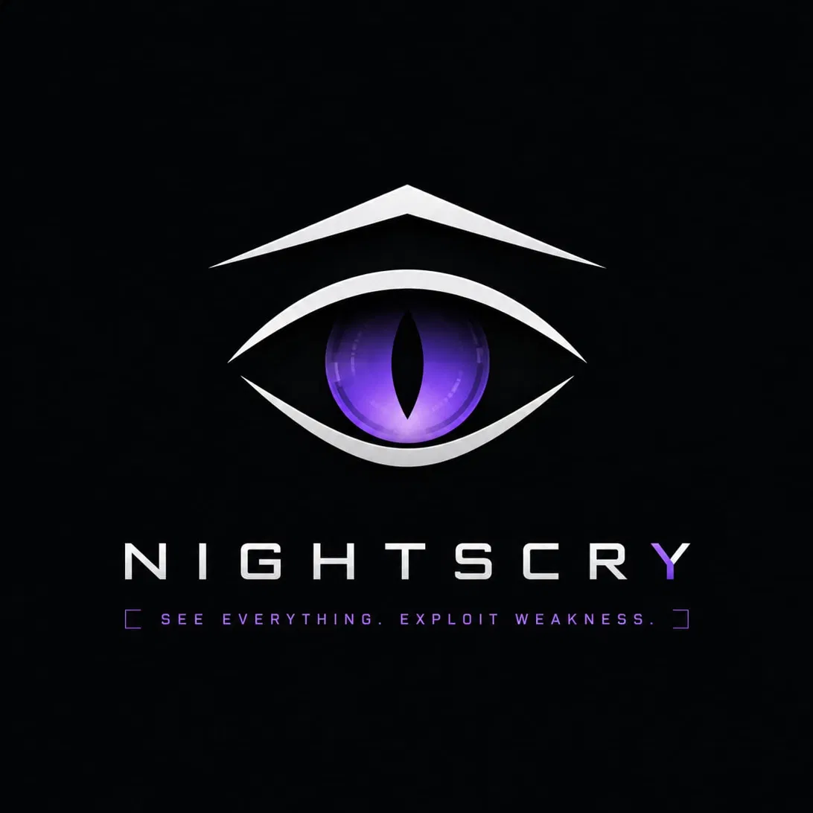

<div align="center">



# EyeTrace

**See every transaction. Trace every wallet.**

Multi-chain blockchain intelligence and wallet transaction tracer, with an interactive force-directed graph.


<sub>a NightScry project</sub>

</div>

---

## What it is

EyeTrace takes a wallet address, detects its blockchain, fetches balance and transactions, and draws an interactive graph of its counterparties — draggable nodes, spring-based physics, and a side panel with the selected wallet's details.

Built for on-chain investigative analysis: following the flow of money between wallets, exchanges, and services.

---

## Features

- **Automatic chain detection** from the address alone, with cryptographic checksum validation (not just pattern matching):
  - Bitcoin Base58Check (P2PKH, P2SH) and Bech32 / Bech32m (SegWit, Taproot)
  - Ethereum EIP-55 (Keccak-256)
  - Dogecoin and Tron Base58Check
  - Ripple Base58 (XRPL alphabet)
- **Keyless connectors** — no API key required (BTC via Blockstream, ETH via Blockscout, DOGE via BlockCypher)
- **Interactive force-directed graph** — draggable nodes, spring layout, continuous animation
- **Details panel** — balance, address, amounts exchanged, transaction count (unit adapts per chain)
- **Native UI** with the NightScry theme (Fyne)

---

## Supported chains

| Chain | Detection + Checksum | Connector (on-chain data) |
|-------|:--------------------:|:-------------------------:|
| Bitcoin (Legacy/SegWit/Taproot) | Yes | Yes |
| Ethereum / EVM | Yes | Yes |
| Dogecoin | Yes | Yes |
| Tron | Yes | Planned |
| XRP | Yes | Planned |
| Solana | Pattern only | Planned |

<sub>Solana addresses are raw Ed25519 public keys: they carry no checksum to verify, so validation is limited to alphabet and length by design.</sub>

---

## Getting Started

```bash
# clone
git clone https://github.com/nightscry/EyeTracker.git && cd EyeTracker

# dependencies
go mod download

# run
go run .
```

No API keys to configure: the connectors use keyless public explorers.

> Requirements: Go 1.25+, a C compiler (for Fyne/OpenGL — on macOS, the Xcode Command Line Tools).

Try any address, for example:

```
1A1zP1eP5QGefi2DMPTfTL5SLmv7DivfNa                  (BTC — genesis block)
0xd8dA6BF26964aF9D7eEd9e03E53415D37aA96045          (ETH — vitalik.eth)
```

---

## Architecture

```
Address -> Detect chain -> Connector -> []Transfer -> Graph Builder -> GUI
             (checksum)     (keyless)   (normalized      (physics)     (Fyne)
                                         model)
```

```
eyetracker/
├── eyetracker.go          # entrypoint -> gui.RunGUI()
├── src/                   # core (package src)
│   ├── wallet.go          # Wallet + Identification (detection)
│   ├── checksum.go        # Base58Check, Bech32/m, EIP-55
│   ├── validate.go        # alphabets + validation
│   ├── model.go           # Transfer, Wallet, Connector interface
│   ├── BTCconnector.go    # Blockstream (UTXO model)
│   ├── ETHConnector.go    # Blockscout (account model)
│   └── DOGEConnector.go   # BlockCypher (UTXO model)
└── gui/                   # interface (package gui)
    ├── app.go             # app + theme + splash -> dashboard
    ├── theme.go           # NightScry theme (palette + embedded logo)
    ├── splash.go          # loading screen
    ├── dashboard.go       # main window
    ├── graph.go           # force-directed graph
    └── panel.go           # wallet details panel
```

Core design: a shared `Connector` interface and a chain-agnostic `Transfer`, so adding a chain touches neither the graph nor the GUI.

---

## Roadmap

- [x] Multi-chain detector with checksum validation
- [x] Keyless BTC + ETH + DOGE connectors behind a common interface
- [x] GUI: force-directed graph + details panel + dynamic balance
- [ ] Tron / XRP / Solana connectors
- [ ] Recursive crawling (counterparties of counterparties)
- [ ] Local cache (SQLite)
- [ ] Zoom / pan / directional arrows on the graph
- [ ] Exchange & entity identification (exchange, mixer, bridge labels) + risk score
- [ ] AI-assisted explanations (plain-language summary of an investigation)
- [ ] Report export / save investigations

---

## Stack

Go, Fyne v2 (native GUI), golang.org/x/crypto (Keccak-256), math/big (wei/satoshi precision), keyless explorers (Blockstream, Blockscout, BlockCypher).

---

## License

MIT — see [LICENSE](LICENSE).

---

## Disclaimer

EyeTrace analyzes public on-chain data for research, education, and authorized investigative analysis. Use it responsibly and in compliance with applicable laws.

---

<div align="center">
<sub>a NightScry project</sub>
</div>
